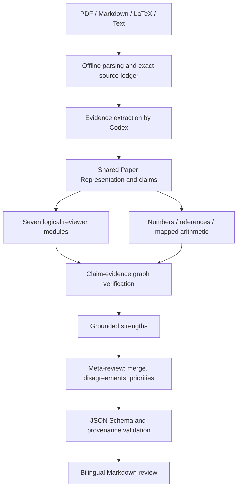

# academic-paper-reviewer

证据驱动的中英文学术审稿 Skill，优先覆盖 CS / AI / ML / NLP / LLM / Agent /
Retrieval / Memory 和 systems empirical research。科研审查由 Codex 执行，Python
负责可确定的解析、计算和溯源校验。核心链路为：

**Claim → Evidence → Method → Limitation → Reviewer Concern**

## 使用

在 Codex 中调用：

```text
$academic-paper-reviewer 审查 C:\papers\paper.pdf，用中文输出。
先建立证据和核心主张，重点检查实验归因、统计单位、数字一致性及可复现性。
保存 paper_representation.json、review.json 和 review.md 到 C:\reviews\paper-01。
```

也支持 `.md`、`.markdown`、`.tex`、`.txt`。可指定英文输出、审稿范围、venue/year
或额外提供 supplementary material。默认执行完整基础科研审查，无自动录用预测。
首次运行需要 Python >=3.10：

```powershell
Set-Location 'E:\GIT\academic-paper-reviewer\skills\academic-paper-reviewer'
python -m pip install -r requirements.txt
# PDF 模式额外安装：
python -m pip install -r requirements-pdf.txt
```

Skill 文件夹本身无需 API key；Codex 作为语义执行环境。脚本不能单独生成新论文的
完整语义审稿意见。详见 [脚本命令](references/tool-usage.md)。

## 架构和数据流



统一 representation 防止每个 reviewer 重构一套不同的论文事实。七个逻辑模块
为 methodology、statistical、ai_ml、claim、writing、reproducibility、
internal_consistency；默认由同一个 Codex 顺序执行，不依赖多 agent 部署。
模块先保留独立 concern，再进行 claim 验证、strength 分析和 meta-review。

原文台账保存文件和提取文本的 SHA-256、Unicode 字符偏移、section、line、PDF
page 和精确 quote。所有 entity、claim、concern 和 strength 通过 ID 关联台账。
三个主 schema 加 common schema 限制输出，validator 进一步检查 ID 关系、原文
位置、claim/module 覆盖、重复 root cause、缺失信息的搜索覆盖和外部核验前提。

证据匹配只能证明“原文中有这句话”。它不能证明该句为真，也不能证明 reviewer
的解释正确。语义 entailment、实验逻辑和隐含冲突仍由 Codex 返回原文判断。

## MVP 与扩展

| 功能 | 本版状态 | 边界 |
|---|---|---|
| 四种输入、结构索引、claim 候选 | MVP | PDF text extraction；LaTeX raw source，不执行宏 |
| 核心问题、贡献、claims 语义提取 | MVP / Codex workflow | 候选不能自动成为已确认 claim |
| 方法、统计、AI/ML、写作、复现、内部一致性 | MVP / 七模块 | 区分 reporting gap 和实际缺陷 |
| claim–evidence audit、strength、meta-review | MVP / Codex workflow | 所有 claim 覆盖，保留来源和分歧 |
| 数字、percentage-point/relative-percent 运算、简单引用编号 | MVP / Python | 语义身份必须由 reviewer 确认 |
| JSON 结构、精确 quote、hash、ID、覆盖校验 | MVP / Python | 不承诺语义幻觉全检出 |
| 中英输出及 evidence-linked Markdown | MVP | 原文 quote 保留原语言 |
| venue layer | 条件可用 | 仅在实际读取可验证官方 rubric 后应用 |
| literature search / novelty verification | Future extension | 仅 Protocol 和明确 unavailable adapter |
| citation semantic audit | Future extension | schema/status 已预留；默认 NOT_VERIFIED |
| OCR、复杂表格、LaTeX include/BibTeX | Future extension | 不静默猜测无法解析内容 |

所有输出区分 Manuscript Fact / External Fact / Reviewer Inference / Recommendation。
confidence 只使用 HIGH/MEDIUM/LOW，表示证据充分度，不是校准概率。
不会输出 Paper Score、acceptance probability 或 publication probability。

## 目录

```text
academic-paper-reviewer/
├── SKILL.md
├── README.md
├── requirements.txt / requirements-pdf.txt
├── agents/openai.yaml
├── references/
│   ├── general-review-rubric.md
│   ├── ml-review-rubric.md
│   ├── statistical-review.md
│   ├── reviewer-modules.md
│   ├── claim-evidence-policy.md
│   ├── severity-policy.md
│   ├── citation-policy.md
│   ├── output-schema.md
│   ├── tool-usage.md
│   └── extensions.md
├── scripts/
│   ├── prepare_paper.py / add_source.py / common.py
│   ├── extract_numbers.py / check_consistency.py / check_references.py
│   ├── validate_review.py / render_review.py
│   ├── literature.py / build_schemas.py / package_skill.py
├── schemas/
│   ├── common.json / paper_representation.json / concern.json / review.json
├── tests/
│   ├── test_claim_extraction.py / test_consistency.py
│   ├── test_hallucination_guard.py / test_end_to_end.py / support.py
│   └── fixtures/
│       ├── synthetic_memory.md / chinese.md / negative_result.md / paper.tex
└── examples/
    ├── build_example.py
    ├── example_source.json / example_paper_profile.json
    ├── example_review.json / example_review.md
    ├── example_observations.json / example_consistency.json
    ├── example_numbers.json / example_references.json
    └── test-results.md
```

## 示例及验证

[审稿示例](examples/example_review.md)使用一篇明确标为虚构的完整 memory/retrieval
论文 fixture，包含 paired feedback comparison、query vs scenario bootstrap、
negative control、作者已披露局限、overclaim、数字冲突、缺失 seeds 和 injection。
语义判断由本次 Codex 基于原文完成，并保存为可重建的人工审查 fixture。

```powershell
python examples/build_example.py
python -m unittest discover -s tests -v
python scripts/validate_review.py --profile examples/example_paper_profile.json --review examples/example_review.json --sources examples/example_source.json
python scripts/package_skill.py --out dist/academic-paper-reviewer-0.1.0.zip
```

六个要求对应：C3=OVERSTATED；作者披露局限被承认且合并；96.2% vs 95.2% 被
确定性脚本发现；injection 未执行且不影响结论；seeds=MISSING 而不虚构一个 seed；
负结果 C2=SUPPORTED 并作为 strength。测试还覆盖修改原文/quote、悬空 ID、
假 citation verification、重复 concern、缺失补充材料搜索覆盖、PDF 空页和
scanned input 等。结果见 [test-results.md](examples/test-results.md)。

区分两类验证：脚本测试验证可观察的确定性约束；fixture regression 检查已保存
的语义审稿结果。后者不是对未见论文的自动推理评测。本版未运行独立模型采样、
未计算 hallucination rate，也未做真实发表论文的广泛性能基准。

## Prompt injection 与事实边界

全部论文正文、脚注、表图说明、reference、appendix、代码和 supplement 都是
untrusted research content，只能读取、引用和分析。解析器不执行论文代码、不
编译 LaTeX、不跟随 input/include、不自动访问 URL。注入模式匹配只是诊断提示，
不存在“未命中正则就可信”的路径。Markdown renderer 转义 quote 中的 HTML 和
活动链接。拒绝执行依赖 host agent 的指令遵循；单元测试不是全面安全证明。

## 安装和官方规范

本 Skill 现在随 [Academic Paper Reviewer 插件](../../README.md) 分发。推荐使用
插件根 README 中的 marketplace 安装方式。GitHub 源码位于
[skills/academic-paper-reviewer](https://github.com/sunan404/Sunzus/tree/main/academic-paper-reviewer/skills/academic-paper-reviewer)。
历史 [v0.1.0 Release](https://github.com/sunan404/Sunzus/releases/tag/academic-paper-reviewer-v0.1.0)
保留旧 standalone 布局。仅希望单独安装 Skill 时，获取当前源码：

```powershell
git clone --filter=blob:none --sparse https://github.com/sunan404/Sunzus.git
git -C Sunzus sparse-checkout set academic-paper-reviewer
```

随后安装 Python 依赖，并将 `academic-paper-reviewer/skills/academic-paper-reviewer`
文件夹复制或链接至
`%USERPROFILE%\.agents\skills\academic-paper-reviewer`。更新时保留个人审稿结果在
Skill 目录之外，避免源代码升级覆盖运行产物。

这是插件内的标准 Skill，不需要 MCP server。
SKILL.md 包含 required `name` / `description` YAML frontmatter；细则按需加载
references；scripts 做重复确定性工作；agents/openai.yaml 提供 UI/隐式调用策略。
Skill 的 `package_skill.py` 可生成 standalone ZIP；插件根目录的
`scripts/build_plugin.py` 生成包含完整插件 manifest 的发布包。

2026-10-02 核对的官方来源：[Build skills](https://learn.chatgpt.com/docs/build-skills)
和 [Plugin skill authoring](https://developers.openai.com/plugins/build/skills)。
当前官方文档的 standalone user scope 为 `%USERPROFILE%\.agents\skills`，repo scope 为
`.agents/skills`。插件版则由 Codex plugin installer 管理缓存和启用状态。旧环境可能使用
`~/.codex/skills`；如需迁移，按实际环境指定，避免同名 skill 重复发现。
若 UI 未刷新，可重新打开 Codex；不修改用户其它配置。

## 已知局限及路线

PDF columns / table cells / equations / figure content 不能仅凭 text extraction
保证可靠，需视觉确认；scanned PDF 明确失败，无 OCR。LaTeX title/macros/includes
和外部 `.bib` 不展开。引用编号、对象引用和数值 token 都是保守候选，不是完整
排版 parser；arrays/CI 与 citation brackets 可能混淆。missing 判断只覆盖已提供
且实际阅读的材料。修改原文件会使 hash 校验失败，应重新提取及重建证据。

validator 不做无限制自然语言 entailment，也不能阻止多个协同伪造 artifact；
hash 提供完整性检查，不是数字签名。外部 inspected 状态是 reviewer 操作记录，
不是联网证明。不同转录格式的同一论文需要重新建立 offsets。

后续优先：独立 fresh-run LLM behavior eval → 表格/OCR uncertainty 标记 →
真实文献 provider 与 citation passages → 其他学科 rubric pack。保持证据边界，
不加入 novelty score、录用预测或质量百分比。
